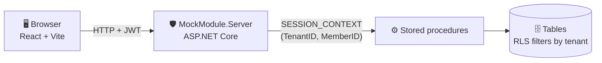
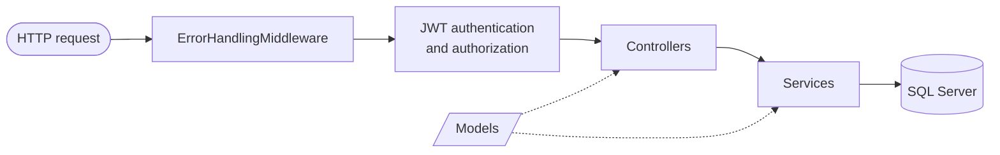
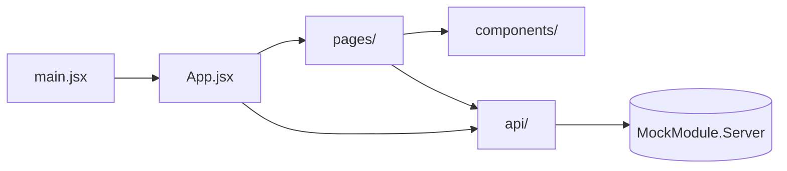
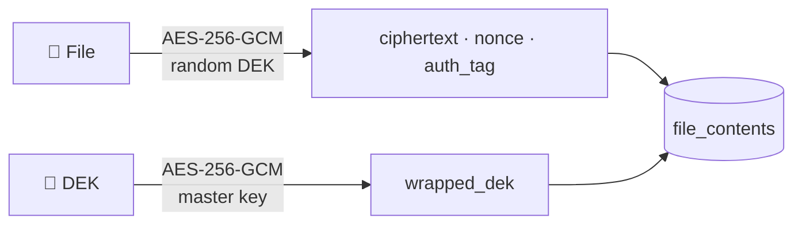
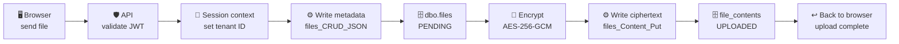
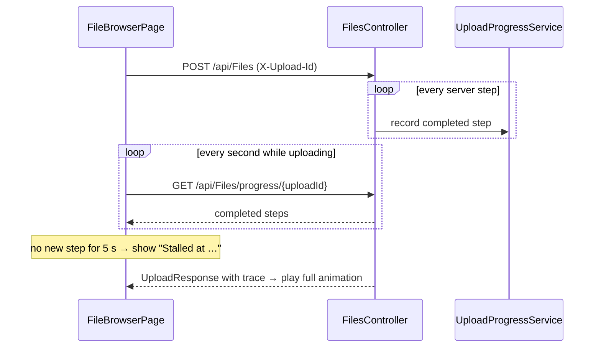

<div align="center">

# 🗂️ Mock Module · Model v8

**Multi-tenant encrypted file storage with a storage-flow animation**


</div>

---

## 📑 Contents

- [✨ Features](#features)
- [🏗️ Architecture](#architecture)
- [🔌 API endpoints](#api-endpoints)
- [🔐 Security model](#security-model)
- [🎞️ Storage animation](#storage-animation)
- [📁 Project structure](#project-structure)
- [📄 What each file does](#what-each-file-does)

---

<a id="features"></a>

## ✨ Features

| | Feature | Description |
|:-:|---|---|
| 🔒 | **Envelope encryption** | Every file is encrypted with its own random data key (AES-256-GCM); the data key is wrapped with a master key that never touches the database. |
| 🏢 | **Multi-tenant** | A user can belong to several tenants and switch between them; SQL Server Row-Level Security shows only the current tenant's files. |
| 🎞️ | **Storage animation** | Every upload is visualised as a left-to-right flow through the API, stored procedures and tables. |
| ⏳ | **Stall & failure detection** | If an upload stalls or fails, the animation stops at the exact step where it happened. |
| 🧱 | **Layered design** | Controllers → Services → Models / Middleware on the backend; pages → components → api on the frontend. |

---

<a id="architecture"></a>

## 🏗️ Architecture



### Backend layers



| Layer | Responsibility |
|---|---|
| **Controllers** | Receive the request → call a service → return the HTTP response |
| **Services** | All business logic, registered in `Program.cs`<br>`AddScoped`: TokenService, UserContextService, FilesService<br>`AddSingleton`: SqlConnectionFactory, EncryptionService, UploadProgressService |
| **Middleware** | `app.UseMiddleware<ErrorHandlingMiddleware>()` turns every exception into JSON |
| **Models** | Plain data records shared by all layers |

### Frontend layers



---

<a id="api-endpoints"></a>

## 🔌 API endpoints

| Method | Route | Permission | Description |
|:--|:--|:--|:--|
| `GET` | `/api/Health` | – | Database reachable, tables and stored procedures installed |
| `GET` | `/api/UserContext/users` | – *(Development only)* | Test users and their tenants |
| `POST` | `/api/UserContext/set-user` | – *(Development only)* | Issues a JWT for a user + tenant (also used to switch tenant) |
| `GET` | `/api/Files` | `files.read` | Files of the current tenant |
| `POST` | `/api/Files` | `files.upload` | Upload and encrypt a file (`multipart/form-data`, header `X-Upload-Id`) |
| `GET` | `/api/Files/progress/{uploadId}` | `files.upload` | Steps an in-progress upload has completed |
| `GET` | `/api/Files/{id}` | `files.read` | Download the decrypted file |
| `DELETE` | `/api/Files/{id}` | `files.delete` | Soft delete (`status = DELETED`) |

Errors are always returned as `{ code, message, trace }`.

---

<a id="security-model"></a>

## 🔐 Security model

**Tenant isolation**

1. The JWT carries `tenant_id`, `member_id` and `permissions`, signed with HMAC-SHA256.
2. On every request, `SqlConnectionFactory` writes `TenantID` / `MemberID` into `SESSION_CONTEXT` (read-only).
3. The RLS policy and the stored procedures read the tenant from `SESSION_CONTEXT`, so other tenants' rows are invisible and cannot be written.

**Envelope encryption** (`EncryptionService`)



| Column | Content |
|---|---|
| `ciphertext` | The file encrypted with its data key (DEK) |
| `nonce` / `auth_tag` | 12-byte nonce and 16-byte tag; any tampering makes decryption fail |
| `wrapped_dek` | The DEK encrypted with the master key: `[nonce 12][tag 16][key 32]` = 60 bytes |
| `plaintext_checksum` | SHA-256 of the original file, verified after decryption |

The associated data (AAD) binds every ciphertext to its tenant and file id, so a ciphertext copied to another row or tenant cannot be decrypted.

---

<a id="storage-animation"></a>

## 🎞️ Storage animation

The full storage flow of an upload is shown as **9 nodes in real execution order**. The packet only moves **left to right**.



| Outcome | What the animation shows |
|---|---|
| ✅ **Uploaded** | The packet plays through every node and stops at *Back to browser* |
| ⏳ **Stalled** | The packet stops at the node that has not finished, with the waiting time |
| ✕ **Failed** | The packet stops at the node that failed, with the error message |

### Stall detection



---

<a id="project-structure"></a>

## 📁 Project structure

```
model-v8/
|-- 📄 MockModule.slnx                  Solution (backend .csproj + frontend .esproj)
|-- 🗄️ MockModuleDB/                    Database
|   |-- schema.sql                      Tables, RLS policy, stored procedures, test data
|   |-- README.md                       Database structure notes
|   |-- seed_multitenant.sql            Multi-tenant demo data
|   `-- setup-database.ps1              Database setup script
|-- 🛡️ MockModule.Server/               Backend (ASP.NET Core 10)
|   |-- Program.cs                      Services, middleware, JWT authentication, permission policies
|   |-- Controllers/                    HTTP endpoints
|   |   |-- FilesController.cs
|   |   |-- UserContextController.cs
|   |   `-- HealthController.cs
|   |-- Services/                       Business logic
|   |   |-- FilesService.cs
|   |   |-- UserContextService.cs
|   |   |-- TokenService.cs
|   |   |-- EncryptionService.cs
|   |   |-- SqlConnectionFactory.cs
|   |   |-- UploadProgressService.cs
|   |   `-- DevelopmentKeys.cs
|   |-- Models/                         Data shapes shared by all layers
|   |   |-- FileModels.cs
|   |   |-- UserModels.cs
|   |   `-- StepModels.cs
|   |-- Middleware/                     Between the request and the controllers
|   |   |-- ErrorHandlingMiddleware.cs
|   |   `-- ApiException.cs
|   |-- MockModule.Server.csproj / .http
|   |-- appsettings.json / appsettings.Development.json
|   `-- Properties/launchSettings.json
`-- 🖥️ mockmodule.client/               Frontend (React 19 + Vite 8)
    |-- mockmodule.client.esproj / package.json / vite.config.js / index.html
    `-- src/
        |-- main.jsx                    Entry point
        |-- App.jsx / App.css           Header + page switching
        |-- index.css                   Global styles
        |-- pages/
        |   |-- LoginPage.jsx
        |   `-- FileBrowserPage.jsx
        |-- components/
        |   |-- StorageAnimation.jsx / .css
        |   |-- useStorageAnimation.js
        |   |-- FileTable.jsx
        |   |-- UploadForm.jsx
        |   `-- TenantSwitcher.jsx
        |-- api/                        One file per backend controller
        |   |-- apiClient.js
        |   |-- filesApi.jsx
        |   |-- userContextApi.jsx
        |   `-- healthApi.jsx
        `-- utils/format.js             Small display helpers
```

---

<a id="what-each-file-does"></a>

## 📄 What each file does

<details open>
<summary><b>🛡️ MockModule.Server</b> — backend</summary>
<br>

| File | Layer | Purpose |
|---|---|---|
| `Program.cs` | Startup | Generates development keys; registers controllers, OpenAPI and services; configures JwtBearer; one authorization policy per permission; request pipeline |
| `Controllers/FilesController.cs` | Controller | List, upload, upload progress, download and soft delete; each endpoint requires the matching permission |
| `Controllers/UserContextController.cs` | Controller | Test users and `set-user`; available only in Development with standalone mode on, otherwise 404 |
| `Controllers/HealthController.cs` | Controller | Database and schema health check |
| `Services/FilesService.cs` | Service | Uses the three stored procedures for list, upload, download and delete:<br>• records every upload step in a `StepTrace`<br>• calls `files_Content_Put` inside a transaction<br>• soft-deletes a leftover `PENDING` row if storing the content fails<br>• reports the step at which an unexpected error happened |
| `Services/UserContextService.cs` | Service | Reads test users and tenants, checks membership, asks TokenService for a JWT |
| `Services/TokenService.cs` | Service | Creates and validates JWTs (`tenant_id` / `member_id` / `permissions`, HMAC-SHA256) |
| `Services/EncryptionService.cs` | Service | Envelope encryption with AES-256-GCM and AAD bound to tenant + file id |
| `Services/SqlConnectionFactory.cs` | Service | The only place that opens SQL connections; sets `SESSION_CONTEXT`; health check |
| `Services/UploadProgressService.cs` | Service | In-memory progress of running uploads, removed when the upload ends |
| `Services/DevelopmentKeys.cs` | Service | Generates the signing key and master key into user-secrets in Development; never overwrites existing keys |
| `Models/FileModels.cs` | Model | `FileRow`, `FileIdResult`, `UploadResponse`, `DownloadedFile`, `EncryptedFile`, `HealthReport` |
| `Models/UserModels.cs` | Model | `Tenant`, `TestUser`, `SetUserRequest`, `SessionResponse`, `CurrentUser` (read from JWT claims) |
| `Models/StepModels.cs` | Model | `Step`, `TableRow`, `StepTrace` (measured duration of each step) |
| `Middleware/ErrorHandlingMiddleware.cs` | Middleware | Exceptions → `{ code, message, trace }`; maps SQL errors 50001 / 50003 / 33504 to HTTP status codes |
| `Middleware/ApiException.cs` | Middleware | Expected errors with status code, error code and optional trace |

</details>

<details open>
<summary><b>🖥️ mockmodule.client</b> — frontend</summary>
<br>

| File | Layer | Purpose |
|---|---|---|
| `main.jsx` | Entry | Loads `index.css` and mounts `<App />` |
| `App.jsx` / `App.css` | Top level | Health check, test users, header (user selector, tenant switcher, sign out); LoginPage or FileBrowserPage |
| `pages/LoginPage.jsx` | Page | Choose a test user and tenant |
| `pages/FileBrowserPage.jsx` | Page | Upload with send progress and stall detection, animation, file list, download, delete, refresh |
| `components/StorageAnimation.jsx` / `.css` | Component | The 9-node left-to-right flow chart |
| `components/useStorageAnimation.js` | Component | `play`, `show`, `clear`; `stagesOf()` maps server steps to nodes |
| `components/FileTable.jsx` | Component | File table of the current tenant |
| `components/UploadForm.jsx` | Component | File picker, upload button, send progress |
| `components/TenantSwitcher.jsx` | Component | Tenant buttons, coloured per tenant |
| `api/apiClient.js` | api | Shared helpers: `ApiError`, JSON requests, error parsing |
| `api/filesApi.jsx` | api | FilesController calls: list, upload (XHR with progress), progress, download, delete |
| `api/userContextApi.jsx` | api | UserContextController calls: `getUsers`, `setUserContext` |
| `api/healthApi.jsx` | api | HealthController call |
| `utils/format.js` | Helpers | Byte and time formatting, short ids, tenant colours |

</details>

<details open>
<summary><b>🗄️ MockModuleDB</b> — database</summary>
<br>

| File | Purpose |
|---|---|
| `schema.sql` | 5 tables (`users`, `tenants`, `tenant_memberships`, `files`, `file_contents`), RLS predicate and security policy, 3 stored procedures (`files_CRUD_JSON`, `files_Content_Put`, `files_Content_Get`), test data |
| `README.md` | Database structure notes |
| `seed_multitenant.sql` | Adds Tenant C; afterwards **Andy** belongs to A / B / C and **Bob** to B / C |
| `setup-database.ps1` | Create database → `schema.sql` (skipped if installed) → `seed_multitenant.sql` |

</details>
